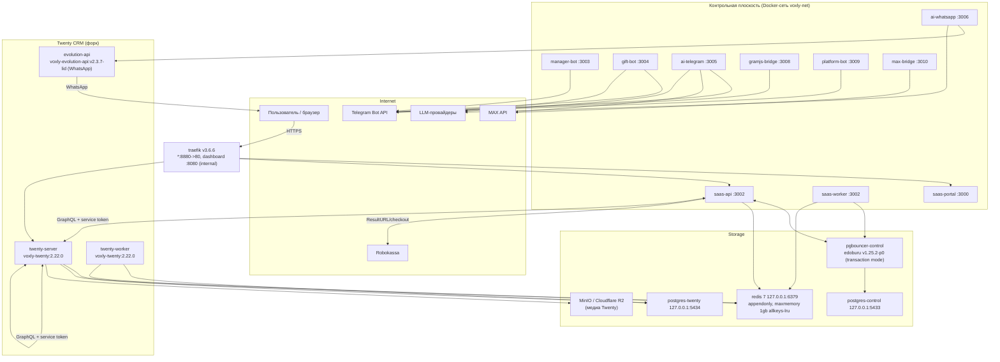

# System Overview — топология платформы Voxly

> Все утверждения ниже проверены по коду репозитория `/Users/antonsagajdak/Desktop/CRM-PLUS`.
> Дата ревизии: 2026-08-16.

## 1. Что это

Voxly — мультитенантная SaaS-платформа на базе форка Twenty CRM (`twenty-app/`, образ `voxly-twenty:2.22.0`) с собственной контрольной плоскостью:

- **saas-api** (`apps/saas-api/src/index.ts`, Fastify, порт по умолчанию `API_PORT=3002`) — auth, биллинг (Robokassa), provisioning воркспейсов Twenty, админ-роуты, внутренние `/api/internal/*` роуты для ботов/мостов.
- **saas-worker** (`apps/saas-api/src/worker.ts`) — тот же код приложения без HTTP: BullMQ-воркеры (`provisioningWorker`, `emailWorker`, `formLeadWorker`, `gramjsCrmEnrichWorker`, `aiUsageWorker`, `timelineSyncWorker` из `apps/saas-api/src/jobs/queues.ts`) + `startScheduledJobs()` (cron).
- **saas-portal** (`apps/saas-portal`) — фронт кабинета (порт 3000).
- Канальные воркеры/мосты: `apps/manager-bot-service` (3003), `apps/gift-bot-worker` (3004), `apps/ai-telegram-worker` (3005), `apps/ai-whatsapp-worker` (3006), `apps/gramjs-bridge` (3008), `apps/platform-bot-service` (3009), `apps/max-bridge` (3010).
- Общие пакеты: `packages/db` (Prisma), `packages/billing` (Robokassa), `packages/shared` (константы, service-auth), `packages/ai-core` (AI-списания), `packages/twenty-client` (GraphQL/SQL-клиент Twenty), `packages/crypto` (AES-256-GCM), `packages/analytics-dispatchers`.

## 2. Топология (prod)

Ключевые связи по коду:

- saas-api → Twenty: `new TwentyClient({ apiUrl: process.env.TWENTY_API_URL || 'http://twenty-server:3000/graphql', apiKey: process.env.TWENTY_API_KEY })` (`apps/saas-api/src/index.ts:131-134`, `apps/saas-api/src/jobs/queues.ts:68-71`).
- saas-api → боты/мосты: внутренние роуты `/api/internal/platform-bot`, `/api/internal/max`, `/api/internal/gramjs`, `/api/internal/crm` (`apps/saas-api/src/index.ts:272-279`) — аутентификация через `verifyServiceToken` из `packages/shared/src/service-auth.ts`.
- Redis: `REDIS_URL` (default `redis://localhost:6379`) — BullMQ-очереди и scheduler-lock (`apps/saas-api/src/jobs/queues.ts:23`, `apps/saas-api/src/jobs/scheduler-lock.ts:3`).

## 3. Матрица окружений prod vs local

| Компонент | Prod (`/opt/voxly`, хост `150.241.98.135`) | Local (`docker/docker-compose.yml` + `docker-compose.override.yml`) | Дрифт / риск |
|---|---|---|---|
| traefik | v3.6.6; `8880->80`, dashboard `8080` только внутренний | `traefik:v3.1` (`docker/docker-compose.yml:21`), порт `80:80`, traefik опционален (override даёт прямые порты) | **Версионный дрифт 3.1 vs 3.6.6** — локально не проверяются новые возможности/поведение middleware prod |
| postgres-control | `127.0.0.1:5433` (postgres:16-alpine) | `5433:5432` (`docker-compose.yml:53-61`) | совместимо |
| pgbouncer-control | edoburu `v1.25.2-p0`, transaction mode | тот же образ (`docker-compose.yml:78`) | совместимо; учти transaction-pooling при написании сырых SQL с session-state |
| postgres-twenty | `127.0.0.1:5434` | `5434:5432` (`docker-compose.yml:110-117`) | совместимо |
| redis | redis 7, `127.0.0.1:6379`, appendonly, `maxmemory 1gb`, `allkeys-lru` | redis:7-alpine (`docker-compose.yml:130-134`) | local без явного `maxmemory-policy allkeys-lru` — поведение вытеснения ключей BullMQ может отличаться (проверь override перед отладкой очередей) |
| twenty-server/worker | `voxly-twenty:2.22.0` | `voxly-twenty:2.22.0` (`docker-compose.yml:147,214`) | совпадает |
| evolution-api | `voxly-evolution-api:v2.3.7-lid` (порт контейнера — см. compose profile `whatsapp`) | `docker-compose.yml:605-608`, profile `whatsapp` | включается по профилю; патч `docker/patch-evolution-lid-pn.cjs` |
| saas-api | 3002 | 3002 (`API_PORT` default) | совпадает |
| saas-worker | 3002 (без внешнего HTTP) | из `apps/saas-api` (`worker.ts`) | совпадает |
| saas-portal | 3000 | 3000 | совпадает |
| manager-bot | 3003 | `apps/manager-bot-service` | совпадает |
| gift-bot | 3004 | `apps/gift-bot-worker` | совпадает |
| ai-telegram | 3005 | `apps/ai-telegram-worker` | совпадает |
| ai-whatsapp | 3006 | `apps/ai-whatsapp-worker` | совпадает |
| gramjs-bridge | 3008 | profile `gramjs` (`docker-compose.yml:553-554`) | по умолчанию выключен локально |
| platform-bot | 3009 | `apps/platform-bot-service` | совпадает |
| max-bridge | 3010 | profile `max` (`docker-compose.yml:582-583`) | по умолчанию выключен локально |

Prod-специфика из кода/инфраструктуры (задокументировано, проверяется на месте):

- Входящий HTTPS терминируется traefik на `8880->80`; dashboard `8080` не публикован наружу.
- Все порты БД/Redis биндятся только на `127.0.0.1` — доступ исключительно с хоста/из контейнеров.
- Домен по умолчанию `VOXLY_DOMAIN=getvoxly.ru` (`apps/saas-api/src/index.ts:46`); CORS разрешает `https://{VOXLY_DOMAIN}`, поддомены и localhost (`isAllowedCorsOrigin`, там же, строки 48-53).

## 4. Безопасность на уровне входа saas-api

- JWT: `JWT_SECRET` обязателен в production — иначе процесс падает при старте (`apps/saas-api/src/index.ts:96-101`). Default dev-значение `'dev-secret-change-me'` — плейсхолдер, в prod недопустим.
- Cookies: `COOKIE_SECRET` (fallback `JWT_SECRET`), `httpOnly`, `secure` в prod, `sameSite: lax`.
- Rate limit: 120 req/min на IP (`@fastify/rate-limit`).
- Service-токены между сервисами: `VOXLY_TOKEN_SAAS_API` с fallback `VOXLY_SERVICE_TOKEN`; сравнение constant-time без early-exit (`packages/shared/src/service-auth.ts:72`).
- `maxParamLength: 8192` (signed media tokens), `bodyLimit: 52MB` (gift media multipart) — `apps/saas-api/src/index.ts:62-64`.

## 5. Известные риски/ломкие места

- **Дрифт traefik 3.1 (local) vs 3.6.6 (prod)** — локальная проверка роутинга/middleware не гарантирует prod-поведение.
- `ROBOKASSA_*` при незаполненных кредах API стартуется с warning, но чекаут будет с невалидными подписями (`apps/saas-api/src/index.ts:125-129`).
- Scheduler fail-open: при недоступном Redis cron-задания выполняются без блокировки (`'unlocked-error'`, см. [cron-scheduler-locks.md](./cron-scheduler-locks.md)) — при двух репликах без Redis возможно задвоение.
- Две раздельные Postgres (control + twenty): транзакционность между ними невозможна; см. [database-and-migrations.md](./database-and-migrations.md).
