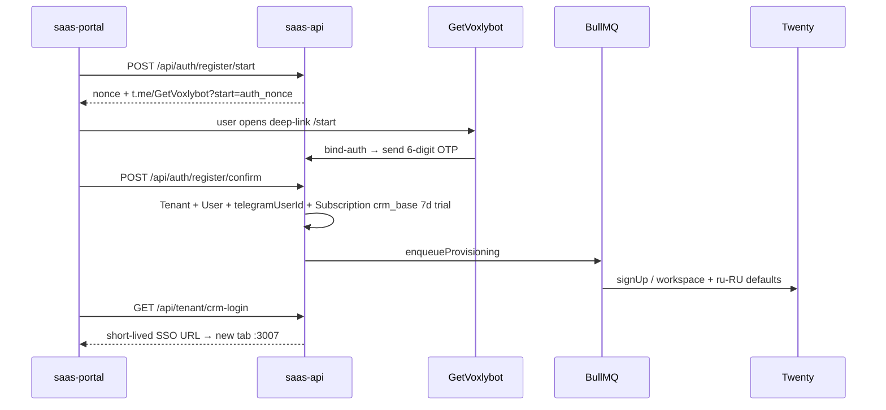
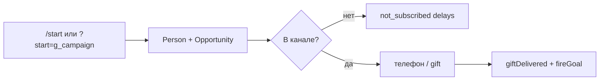

# Ключевые потоки

Пути — точки входа; детали — graphify/code.

## 1. Регистрация → OTP GetVoxlybot → trial CRM → SSO

- Auth OTP: `apps/saas-api/src/routes/auth.ts`, `services/auth-otp.ts`; bot webhook `apps/platform-bot-service`
- Login: `POST /login` → `{ needsOtp, nonce }` (superadmin — сразу JWT); `POST /login/confirm`
- Provision: `apps/saas-api/src/services/provisioning.ts`, `jobs/queues.ts`
- Portal: `apps/saas-portal/src/app/register/page.tsx`, `login/page.tsx`, dashboard CRM button
- **Hard lock (ADR-023):** after trial end or paid endsAt+grace / `tenant.suspended` → SSO/`crm-login` 402|403, invite blocked, CRM chat+media gated; Twenty workspace `activationStatus=INACTIVE` (reversible on pay). Shared: `evaluateCrmAccess`. Portal: `/dashboard/crm` paywall.

## 2. Gift-бот: trial → Managed Bot → кампания

1. `POST /api/bots/gift/start-trial` → Addon + BotInstance placeholder  
2. `POST /api/bots/provision-link` → deep-link к Manager Bot (`@VoxlyGiftbot`)  
3. manager-bot-service: `getManagedBotToken` → encrypt → `BotInstance`  
4. Username: `voxly_{slug}_{01}_bot` (`buildVoxlyBotUsername`)  
5. Портал: канал verify → promo → funnel → subscribers  

Файлы: `routes/bots.ts`, `apps/manager-bot-service`, portal `dashboard/bots/**`.

## 3. Воронка gift (пользователь)

- Worker: `apps/gift-bot-worker/src/index.ts`  
- Медиа: `file_id` + `detectStoredMediaKind` / `resolveTelegramMedia`  
- Inbound CRM: `storeInboundMessage` stores attachments; **`enrichGiftInboundMedia`** (ASR/vision/PDF/DOCX via `@voxly/ai-core` + OpenRouter) when key present — same tags as AI channels; gift funnel does not LLM-reply (`ai_tg` forwarded to telegram-worker)  
- Markdown: `packages/shared/src/telegram-md.ts` → MarkdownV2  
- Напоминания: `not_gifted` / `not_subscribed` / `after_gift`  
- Локально: long-poll, не публичный webhook

## 4. Чат оператора (сейчас)

**AI / мессенджеры (поведение, debounce, typing, CRM sync):** см. **`CHAT.md`** — golden path (WA эталон ✅ 2026-07-26).

**Портал:** UI → `GET .../subscribers/:id/messages` → `POST .../reply` → Telegram + `Conversation.mode=human` + note на Person в Twenty.

**CRM card (SDK) — UX contract (не регрессировать):**
1. Вкладка «Чат» на Person и Opportunity.
2. История из Prisma (`ChatMessage`), роли Клиент / имя оператора (Twenty workspaceMember) / Бот.
3. Composer **pinned at bottom** (host `twenty-shell-ux.js` locks `.page-layout-scroll-wrapper` overflow + widget height; panel root absolute/flex fill; only message list `overflowY:auto` — INC-019). Textarea + right column **Прикрепить** (above) / **Отправить**; multi-file chips; Enter = send. Outbound: saas-api one file/reply → sequential `/reply` (caption on first). Clear draft/files only after success; remount textarea via `composerKey` (INC-016); `sending` cleared in `finally` then `void load()` (INC-015).
4. Формат Telegram client-MD: **always-visible toolbar** above textarea (Жирный/Курсив/Зачёркнутый/Спойлер/Код) wraps selection; Remote DOM: **no ПКМ** (contextmenu preventDefault unreliable), без `.focus()` / `setSelectionRange`. Display also renders `_italic_`.
5. Inbound media: **photo/sticker `` preview** via `/s/crm-chat/.../file/...` → logic compresses JPEG ≤~48KB raw then `{ dataBase64, contentType: image/jpeg }` (INC-014 size cliff); **video/audio** via HMAC signed URL + MIME sniff/Range; other attachments = download link or 📎 fallback; hide bare placeholders when attachments exist. **AI/gift understanding** (worker-global): ChatMessage content may already contain `[голос|кружочек|видео|фото|документ …]: …` — INC-063. Outbound: host patch encodes file → `dataBase64` on change (INC-017) **with JPEG shrink** so JSON stays under Nest 10MB (INC-020); front stores `PendingAttachment` (top-level `event.files`) and posts sequential JSON `fileBase64` (Remote DOM File stubs are **not** Blobs — no FileReader/arrayBuffer in worker); logic rebuilds multipart → saas-api.
6. Reference implement: inject `docker/twenty-deal-chat.js` (rollback; real-DOM `FormData`+File — not usable in SDK front).

Transport: RestApiClient `/s/crm-chat/:recordId` (+ `/reply`, `/file/:fileId`) → logic → saas-api. File route returns compressed `{ dataBase64, contentType }` (binary via service token). Inject floating UI off. saas-api resolves chat via **GiftSubscriber** (gift) **or** **Conversation** CRM ids (`ai_tg` / `ai_gramjs` / `ai_wa`); GET may return `threads[]` for multi-channel switch (`?conversationId=`); GramJS outbound → bridge `POST /messages/send`; WA outbound → ai-whatsapp-worker (INC-032/037).

**Кабинет:** сайдбар «Кабинет Voxly» (`NavigationMenuItemType.LINK` → portal `/dashboard`); floating inject `twenty-cabinet-link.js` отключён (`DISABLE_FLOATING_CABINET`).

## 5. Promo post в канале

`PUT /api/bots/:id/promo` → `POST .../media` (multipart→Telegram file_id) → `POST .../promo/publish`  
Кнопка `Текст · N`, deep-link `?start=g_{campaignId}`; клики → `promoPost.clickCount` + ConversionEvent.

## 6. Рассылки

CRM sidebar «Рассылка» (FOLDER+LINK) → portal `/dashboard/mailing/*` (ADR-018).  
Bot / GramJS / WA / stories → `POST/GET/PATCH /api/bots/:id/broadcasts` (+ soft-gate mailing_*).  
Worker: gift send / bridge / Evolution / GramJS `stories.SendStory`; tags `lastMailing*`; inbound → CRM note (48h).  
Billing: Robokassa checkout mailing_bot|mailing_accounts|mailing_stories; trial via `/api/bots/mailing/start-trial`.

## 7. Биллинг

`POST /api/billing/checkout` → Robokassa `Index.aspx` (`IsTest=1` when `ROBOKASSA_IS_TEST=1`) → ResultURL `GET|POST /api/billing/result` → reply `OK{InvId}` → activate Subscription/Addon. Success → `/api/billing/success` → portal dashboard; Fail → `/api/billing/fail`.

Signatures (hash = `ROBOKASSA_HASH_ALG`, must match ЛК): pay `MerchantLogin:OutSum:InvId[:Receipt]:Password1:Shp_*`; Result `OutSum:InvId:Password2:Shp_*`. Test mode uses **test** Password#1/#2 only. Receipt JSON in signature = **raw** (not URL-encoded) — INC error 29.
Пакет: `packages/billing`.

### Robokassa кабинет (магазин `crmgetvoxly`) — сохранить для модулей

| Параметр | Значение |
|---|---|
| MerchantLogin | `crmgetvoxly` |
| Алгоритм (боевой + тестовый) | **SHA256** → prod `ROBOKASSA_HASH_ALG=sha256` |
| Result URL | `https://api.getvoxly.ru/api/billing/result` **POST** |
| Success URL | `https://api.getvoxly.ru/api/billing/success` **GET** |
| Fail URL | `https://api.getvoxly.ru/api/billing/fail` **GET** |
| Prod env | `ROBOKASSA_LOGIN`, `PASSWORD1/2` (test или live), `ROBOKASSA_IS_TEST=0\|1` |
| SKUs reuse | `crm_base`+`extraSeats`, `extra_seat`, `mailing_*`, `ai_*`, `ai_topup` — один Result webhook |

Секреты только в `/opt/voxly/.env` (не в git). **Live (2026-08-02):** Password#1/#2 + `ROBOKASSA_IS_TEST=0` на prod.

## 8. Аналитика S2S

Integrations CRUD `/api/analytics` → `fireGoal` / `POST .../fire` → `@voxly/analytics-dispatchers`.  
Админ воронки: `GET /api/admin/funnels` ← GiftSubscriber + ConversionEvent + promo clicks.
