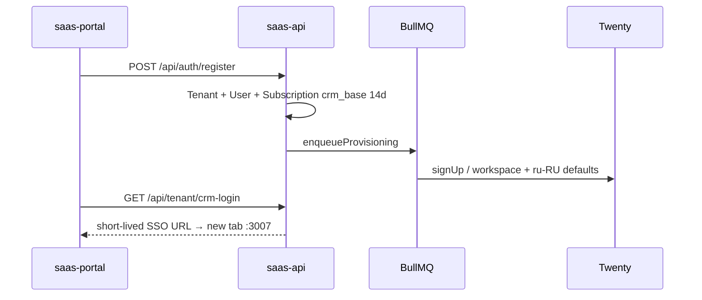
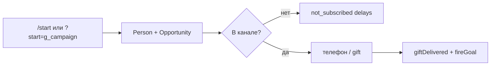

# Ключевые потоки

Пути — точки входа; детали — graphify/code.

## 1. Регистрация → trial CRM → SSO

- Auth: `apps/saas-api/src/routes/auth.ts`
- Provision: `apps/saas-api/src/services/provisioning.ts`, `jobs/queues.ts`
- Portal: `apps/saas-portal/src/app/register/page.tsx`, dashboard CRM button

## 2. Gift-бот: trial → Managed Bot → кампания

1. `POST /api/bots/gift/start-trial` → Addon + BotInstance placeholder  
2. `POST /api/bots/provision-link` → deep-link к Manager Bot (`@VoxlyGiftbot`)  
3. manager-bot-service: `getManagedBotToken` → encrypt → `BotInstance`  
4. Username: `voxly_{slug}_{01}_bot` (`buildVoxlyBotUsername`)  
5. Портал: канал verify → promo → funnel → subscribers  

Файлы: `routes/bots.ts`, `apps/manager-bot-service`, portal `dashboard/bots/**`.

## 3. Воронка gift (пользователь)

- Worker: `apps/gift-bot-worker/src/index.ts`  
- Медиа: `file_id` + `detectStoredMediaKind` / `resolveTelegramMedia`  
- Markdown: `packages/shared/src/telegram-md.ts` → MarkdownV2  
- Напоминания: `not_gifted` / `not_subscribed` / `after_gift`  
- Локально: long-poll, не публичный webhook

## 4. Чат оператора (сейчас)

Portal UI → `GET .../subscribers/:id/messages` → `POST .../reply` → Telegram + `Conversation.mode=human` + note на Person в Twenty.  
SoT сообщений: Prisma `ChatMessage`. CRM deal chat: inject `twenty-deal-chat.js` → `/api/crm/chat/:opportunityId`.

## 5. Promo post в канале

`PUT /api/bots/:id/promo` → `POST .../media` (multipart→Telegram file_id) → `POST .../promo/publish`  
Кнопка `Текст · N`, deep-link `?start=g_{campaignId}`; клики → `promoPost.clickCount` + ConversionEvent.

## 6. Рассылки

Portal `/dashboard/bots/broadcasts` → `POST/GET /api/bots/:id/broadcasts` → gift-worker send (mediaUrl / file_id).

## 7. Биллинг

`POST /api/billing/checkout` → Robokassa → `POST /api/billing/result` (idempotent) → activate Subscription/Addon.  
Пакет: `packages/billing`.

## 8. Аналитика S2S

Integrations CRUD `/api/analytics` → `fireGoal` / `POST .../fire` → `@voxly/analytics-dispatchers`.  
Админ воронки: `GET /api/admin/funnels` ← GiftSubscriber + ConversionEvent + promo clicks.
