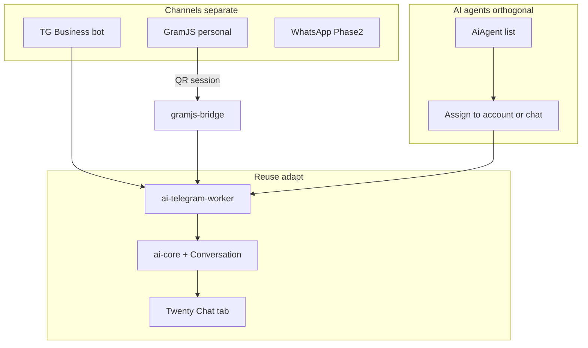

# ТЗ: AI-агент Voxly (Telegram Business + GramJS + WhatsApp)

**Версия:** 0.4.0  
**Статус:** Фаза 1 — product model locked (channels ≠ AI agents; default AI OFF) + schema/runtime/portal split (2026-07-23)  
**Дата:** 2026-07-23  

**Источники:** заказчик (уточнения + **product model lock 2026-07-23**); `docs/ARCHITECTURE.md`, `docs/agent/*`, `steps.md`;  
`apps/ai-telegram-worker`, `apps/ai-whatsapp-worker`, `packages/ai-core`;  
reference `/Users/antonsagajdak/Downloads/server.js` (GramJS tgapi);  
`/Users/antonsagajdak/Downloads/TGBUSINESBOT HTTP @n8n_Sales_academ_bot (1).json` (n8n Business bot).

---

## Locked product model (2026-07-23) — ADR-014

### Channels / accounts (separate surfaces)

1. **GramJS** — personal Telegram accounts connected to CRM (like WhatsApp).
2. **WhatsApp** — connected accounts (Phase 2 / stub OK).
3. **Gift bot** — separate (unchanged).
4. **Business bot** — managed TG bot + ≤10 Business accounts (SKU «Автоматизация чатов» ~1000 ₽/10).

Do **not** merge GramJS into the Business «Автоматизация чатов» card.

### AI layer (orthogonal)

- An **AI agent** can hang on **any** chat from **any** channel (Business, GramJS, WA, gift if wired later).
- Multiple agents → user **selects which agent** applies to that chat and/or account.
- **Default: AI OFF** until an agent is **explicitly assigned** to the chat and/or account.
- Schema: `AiAgent` + `BotInstance.defaultAiAgentId` + `Conversation.aiAgentId` (conversation overrides account; both null = off).
- Handoff pause/disable still apply when an agent is assigned.

### Dashboard UX

| Card / section | Contents |
|---|---|
| **Аккаунты / каналы** | GramJS, WhatsApp (+ links) |
| **Telegram Business** («Автоматизация чатов») | Only Business bot ≤10 |
| **AI-агенты** | List/create agents; assign to accounts/chats |

Paths (minimal churn): `/dashboard/ai` Business; `/dashboard/ai/gramjs` GramJS; `/dashboard/ai/agents` agents.

---

## Архитектурный принцип (жёсткое правило)

> **Если в Voxly уже что-то создано — не создавать новое с нуля. Применять и адаптировать существующее.**

| Уже есть | Действие |
|---|---|
| `apps/ai-telegram-worker` | **Адаптировать** под Telegram Business API + handoff/пауза + имитация человека + медиа. Не писать второй TG AI runtime. |
| `apps/ai-whatsapp-worker` | **Адаптировать** в Фазе 2 под Evolution API (+ та же имитация человека). Не заводить третий WA-стек без необходимости. |
| `packages/ai-core` | Переиспользовать charge / markup / wallet. |
| `Conversation` / `ChatMessage` | Расширить полями канала/паузы/agent — SoT чата не дублировать. |
| `AiAgent` | Tenant agents; assignment via FK on bot/conversation. |
| CRM tab «Чат» (`voxly-crm-chat`) | Единый UI оператора; не отдельный AI-only чат. |
| Managed Bot (manager-bot / gift pattern) | Тот же паттерн provision для AI-бота. |
| Portal `/dashboard/*`, billing addons | Расширить экраны/SKU, не параллельный кабинет. |
| n8n reference | Только **поведение** (имитация, RAG-паттерны) → порт в воркеры. **Не** поднимать n8n как runtime продукта. |
| `Downloads/server.js` | Паттерн API для GramJS-bridge; **не** копировать открытый публичный API as-is. |

Запрещено без явного исключения в ADR: новый «ai-core-v2», отдельная БД чатов, отдельный CRM-чат, второй telegram AI worker, отдельный n8n-контур в проде.

---

## Цель проекта

Дать клиенту Voxly **AI-продавца**, который:

1. отвечает на входящие в **Telegram** (Business bot **и** GramJS) — **только если назначен AI-агент**;
2. отвечает на входящие в **WhatsApp** (**Evolution API**, Фаза 2) — тот же assignment rule;
3. создаёт **лиды в CRM** с проверкой дублей (даже когда AI off);
4. **уступает диалог человеку**: AI по умолчанию **выключен** до назначения агента; после назначения — вкл / выкл / пауза; human outbound → авто-пауза ~1 ч;
5. использует **system prompt агента + FAQ/файлы + историю** → самообучаемый продавец (MVP = RAG + human history).

**Фазы:** 1 — Telegram MVP → 2 — WhatsApp (Evolution).

---

## Описание автоматизированного процесса

### Логика диалога (все каналы)

1. Подключение канала → AI **OFF** (нет назначенного агента).
2. Входящее → `ChatMessage` → лид CRM — **всегда**.
3. Resolve agent: `Conversation.aiAgentId` → else `BotInstance.defaultAiAgentId` → else **no reply**.
4. Если **disabled** / **paused** → AI молчит.
5. Иначе: agent prompt + история → human-like reply → charge wallet.
6. Human outbound → авто-пауза 1ч (если не disabled и агент назначен).

### Биллинг

| Подключение | Фикс | AI usage |
|---|---|---|
| TG Business Bot (≤10) | **1000 ₽/мес** | wallet + markup |
| TG GramJS | **500 ₽/мес** | wallet |
| WhatsApp Evolution | **500 ₽/мес** | wallet |

---

## FR-C. Handoff + assignment (v0.4)

| Состояние | AI отвечает? |
|---|---|
| `no_agent` (оба FK null) | **Нет** (default) |
| агент + mode ai + not disabled/paused | Да |
| `paused` / `disabled` | Нет |

**BREAKING vs v0.2–0.3:** «AI ON when connected» → **OFF until assign**. Existing rows: leave `aiAgentId` null (no mass-enable).

---

## Критерии готовности (добавки v0.4)

- Inbound store + CRM without agent; LLM only with assigned agent.
- Portal: Business / accounts / agents split (GramJS not inside Business card).
- Schema: `AiAgent` + assignment FKs.

---

## Противоречия

| # | Было | Стало |
|---|---|---|
| 7 | AI ON when channel connected | **v0.4 / ADR-014:** OFF until agent assigned |
| 8 | GramJS inside Business UI | Split accounts vs Business vs agents |

---

## Changelog

| Версия | Изменения |
|---|---|
| 0.3.1 | OpenRouter model matrix |
| 0.4.0 | Product model lock: channels ≠ AI agents; default AI OFF; `AiAgent` + FKs; portal split |

---

*See `docs/agent/DECISIONS.md` ADR-014. Soft migration: existing conversations stay agent-null until explicit assign.*
